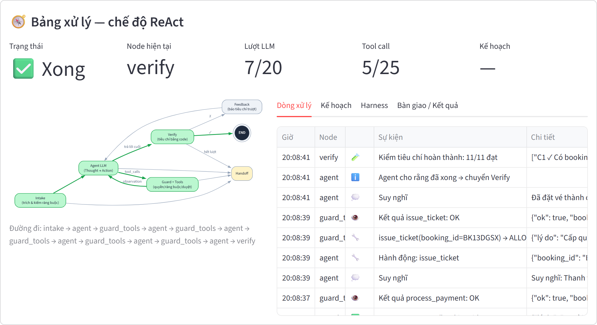
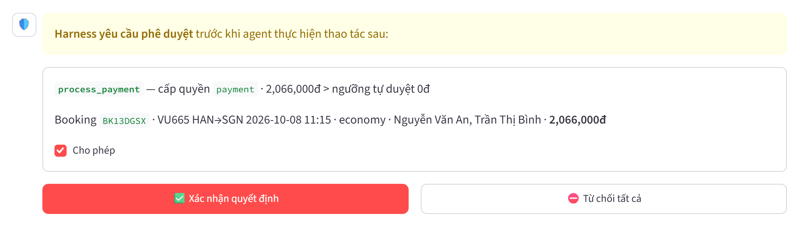

# Agent đặt vé máy bay — LangChain + LangGraph + DeepSeek

Agent đặt vé máy bay một chiều, cài đặt theo 3 mẫu thiết kế (**ReAct**, **Plan-then-Execute**, **Lai**) và chạy trong cùng một lớp **harness** gồm 4 lớp: ràng buộc là dữ liệu, kiểm quyền, tiêu chí hoàn thành kiểm bằng code, và bàn giao. Giao diện Streamlit cho phép chọn chế độ và xem agent đang xử lý tới đâu.



## Tính năng

- 8 tool mockup (tìm chuyến, giữ chỗ, thanh toán, xuất vé, huỷ…) trên dữ liệu chuyến bay giả lập, sinh tất định.
- 3 mẫu agent dựng bằng LangGraph, dùng chung một harness để so sánh công bằng.
- Mọi tool call đi qua cổng `guard_tools`: hạn mức → quyền → 22 luật dữ liệu → phê duyệt người.
- Thanh toán và huỷ vé dừng graph (`interrupt`) chờ người dùng duyệt trên UI.
- Hoàn thành chỉ được công nhận khi đạt đủ 11 tiêu chí kiểm bằng code trên dữ liệu thật.
- Không làm được thì bàn giao có cấu trúc cho khách hoặc nhân viên, lưu thành `logs/HO*.json`.
- Script đánh giá 3 mẫu trên 6 kịch bản có đáp án biết trước.

## Cài đặt

Yêu cầu Python 3.10 trở lên và một API key DeepSeek.

```bash
pip install -r requirements.txt
```

Mở file `.env` (cùng thư mục với README này) và điền key:

```env
DEEPSEEK_API_KEY=sk-...
DEEPSEEK_MODEL=deepseek-chat
DEEPSEEK_API_BASE=https://api.deepseek.com
DEEPSEEK_TEMPERATURE=0
```

`.env.example` là bản mẫu; `.env` và `logs/` đã nằm trong `.gitignore`.

## Chạy ứng dụng

```bash
streamlit run app.py
```

1. Chọn chế độ agent ở sidebar: ReAct, Plan-then-Execute hoặc Lai (Hybrid).
2. Gõ yêu cầu vào khung chat, hoặc bấm một câu mẫu. Yêu cầu cần có điểm đi, điểm đến, ngày bay và họ tên từng hành khách. Ví dụ:
   > Đặt vé Hà Nội đi Sài Gòn ngày 08/10/2026 cho 2 người: Nguyễn Văn An và Trần Thị Bình. Bay thẳng, ngân sách tổng 6 triệu, ưu tiên rẻ nhất.
3. Theo dõi Bảng xử lý ở trên cùng: node đang chạy được tô cam trên sơ đồ graph; bốn tab Dòng xử lý, Kế hoạch, Harness, Bàn giao / Kết quả.
4. Khi agent muốn thanh toán, khung phê duyệt hiện trong chat. Bấm **Xác nhận quyết định** để tiếp tục hoặc **Từ chối tất cả** để dừng và bàn giao.



Ở sidebar có thể chỉnh ngưỡng tự duyệt thanh toán, số lượt LLM, số tool call và số điểm dừng tối đa. Các giá trị này ghi đè `config/policy.json` cho phiên đang chạy.

Mock DB nằm trong bộ nhớ của tiến trình Streamlit: tắt app là mất dữ liệu đặt chỗ.

## Cấu trúc thư mục

```
.env / .env.example         cấu hình DeepSeek
config/policy.json          ràng buộc là dữ liệu: giới hạn, cấp quyền tool, 22 luật kiểm tool
shared/
  mock_db.py                sân bay, hãng bay, sinh chuyến bay, lưu booking
  tools.py                  8 tool mockup (@tool của LangChain)
  llm.py                    khởi tạo ChatDeepSeek từ .env
  state.py                  AgentState dùng chung
harness/
  constraints.py            L1 – TripRequest, kiểm yêu cầu theo policy, bộ thông dịch luật tool
  permissions.py            L2 – allowlist theo chế độ + cấp quyền read/write/payment/destructive
  completion.py             L3 – 11 tiêu chí hoàn thành C1–C11 kiểm trên DB
  handoff.py                L4 – gói bàn giao có cấu trúc, lưu logs/*.json
  nodes.py                  node dùng chung: intake, guard_tools, verify, handoff
ReAct/agent.py              mẫu 1: agent ⇄ guard_tools → verify (trượt → feedback)
Plan-then-Execute/agent.py  mẫu 2: planner → check_plan → executor → guard_tools → record
Lai/agent.py                mẫu 3: planner → step_agent ⇄ guard_tools → replanner (trượt → fix_step)
app.py                      giao diện Streamlit dùng chung
tests/test_harness.py       5 test offline cho harness
evaluation/run_eval.py      đánh giá 3 mẫu trên 6 kịch bản
docs/images/                ảnh chụp giao diện
```

Thư mục `Plan-then-Execute` có dấu gạch ngang nên `app.py` nạp nó bằng `importlib.import_module("Plan-then-Execute.agent")`.

## Kiến trúc

```
START → intake ─┬─(thiếu thông tin / vi phạm policy)──────────────► handoff → END
                └─► [ lõi agent: ReAct | Plan-then-Execute | Lai ] ─► verify ─✓─► END
                          │ mọi tool call                              └✗─► sửa lỗi / handoff
                          ▼
                     guard_tools: hạn mức → quyền → luật dữ liệu → phê duyệt → chạy tool
```

| | ReAct | Plan-then-Execute | Lai |
|---|---|---|---|
| Kế hoạch | Không có | Chi tiết, mỗi bước gắn 1 tool | Mức cao, không gắn tool |
| Ai chọn tool | LLM, mỗi lượt | Kế hoạch; LLM chỉ điền tham số | LLM, trong phạm vi một bước |
| Tool bị chặn | Tự thử cách khác | Bàn giao ngay | Tự thử; replanner có thể sửa kế hoạch |
| Verify trượt | Báo lại cho agent (1 lần) | Bàn giao | Chèn bước khắc phục (tối đa 2 lần) |

## Kiểm thử

```bash
python -m pytest tests -q
```

5 test chạy offline, không cần API key: phân loại yêu cầu thiếu/vi phạm, chặn sai tuyến và vượt ngân sách, luồng phê duyệt có `interrupt`/resume, từ chối thanh toán dẫn tới bàn giao, và allowlist tool theo chế độ.

## Đánh giá 3 mẫu

```bash
python evaluation/run_eval.py --reps 3 --workers 6
```

Script chạy 6 kịch bản × 3 chế độ × 3 lần với DeepSeek thật, tự duyệt mọi yêu cầu phê duyệt, và lưu từng lần chạy vào `evaluation/results.json`. Kết quả đã chạy ngày 01/10/2026 nằm ở `evaluation/results_final.json`:

| | ReAct | Plan-then-Execute | Lai |
|---|---|---|---|
| Đúng | **18/18** | 17/18 | 15/18 |
| Lượt LLM trung bình | 6,2 | 7,2 | 13,0 |
| Token trung bình | 15,8k | **11,2k** | 37,5k |
| Thời gian trung bình | **8,7 giây** | 9,9 giây | 21,6 giây |

Không lần chạy nào xuất sai vé: mọi lần trượt đều kết thúc bằng bàn giao, không thanh toán. Với bài toán ngắn này ReAct hiệu quả nhất; Plan-then-Execute rẻ và dễ kiểm soát nhưng không tự sửa được; planner của Lai đôi khi tự thêm bước "thu thập giấy tờ tuỳ thân" không cần thiết rồi bàn giao.

Các tham số khác: `--modes ReAct Lai` để chạy một số chế độ, `--scenarios S1 S3` để chạy một số kịch bản.
